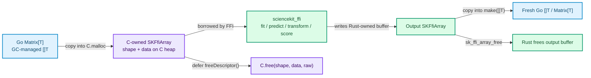

# Dense Matrices and Arrays

`sciencekit-go` exchanges tabular feature matrices and one-dimensional target/prediction vectors with `sciencekit_ffi` through `Matrix[T]`, Go slices `[]T`, and the `Float` type constraint.

## Scalar Types (`Float`)

```go
type Float interface {
	~float32 | ~float64
}
```

- `float32` maps to the native `F32` ABI dtype (`0`).
- `float64` maps to the native `F64` ABI dtype (`1`).
- **Named float types** (`type Celsius float32`, `type Probability float64`) satisfy `~float32 | ~float64`. The binding inspects `reflect.TypeOf(zero).Kind()` to choose the native dtype and converts output slices back into `[]T`.

## Constructing a `Matrix[T]`

`Matrix[T]` represents a dense **row-major** two-dimensional matrix:

```go
type Matrix[T Float] struct {
	Rows    int
	Columns int
	Data    []T
}
```

Element `(row, column)` (0-indexed) sits at `matrix.Data[row*matrix.Columns + column]`.

Always prefer `NewMatrix` to construct a matrix:

```go
// 2 rows × 3 columns in row-major order:
//   [ 1, 2, 3 ]
//   [ 4, 5, 6 ]
matrix, err := sciencekit.NewMatrix(2, 3, []float64{
	1, 2, 3,
	4, 5, 6,
})
if err != nil {
	return err
}
```

`NewMatrix` **borrows** `data` without copying it in Go and validates two invariants immediately:
1. `rows > 0 && columns > 0`
2. `len(data) == rows * columns`

If either check fails, `NewMatrix` returns `StatusInvalidArgument` (`Operation: "new_matrix"`). Even if you construct a `Matrix[T]{...}` struct literal directly, every estimator method (`Fit`, `Predict`, `Score`, `Transform`) re-validates `Rows`, `Columns`, and `len(Data)` in Go before making any `cgo` call (`TestDescriptorRejectsMalformedMatrix` in `arrays_test.go`).

## Target and Prediction Vectors

Targets (`Fit`, `Score`) and regression predictions (`Predict`) are plain Go slices `[]T`:
- Target vectors must be non-empty and satisfy `len(targets) == features.Rows`; mismatches fail in Go with `StatusInvalidArgument` before reaching `cgo`.
- `Predict` returns a freshly allocated `[]T` of length `features.Rows`.
- `Transform` returns a freshly allocated `Matrix[T]` of shape `features.Rows × features.Columns`.

## Memory Ownership Across `cgo` (`GOEXPERIMENT=cgocheck2`)

Go's cgo pointer passing rules strictly forbid storing a Go heap pointer inside C-allocated memory, even temporarily: `runtime.KeepAlive` keeps an object reachable from GC, **not** pinned or legal to embed inside a C struct such as `SKFfiArray`.



For every call:
1. **Inputs:** `newDescriptor` allocates `SKFfiArray` (`C.calloc`), its `shape` buffer (`C.malloc`), and its contiguous row-major `data` buffer (`C.malloc`), copies the Go slice in once, and releases all three buffers via `defer freeDescriptor()`. Mutating or garbage-collecting your Go slice during or after a call cannot corrupt C memory (`TestDescriptorCopiesDataIntoCMemory` in `arrays_test.go`).
2. **Outputs:** `Predict` and `Transform` pass a zeroed C `SKFfiArray` out-descriptor to `sk_ffi_predict` / `sk_ffi_transform`, copy the resulting elements and shape into newly allocated Go slices, release the Rust-allocated payload with `sk_ffi_array_free`, and `C.free` the descriptor shell (`large_test.go` exercises multi-thousand-row matrices through both paths).
