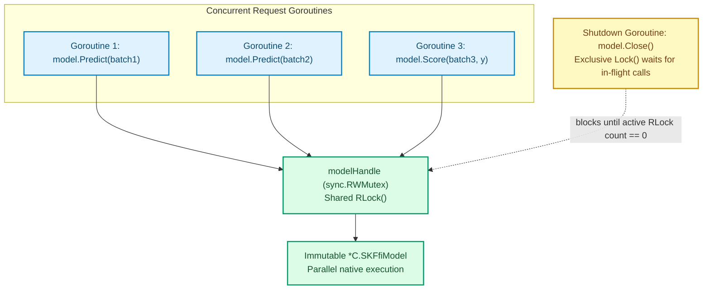

# Concurrency Safety

Go services routinely score requests across hundreds of goroutines at once. `sciencekit-go` makes its concurrency guarantees explicit in the wrapper types so callers do not need external mutexes around shared models or builders.

## Summary of Synchronization Rules

| Type | Internal Lock | Concurrent Reads (`Predict` / `Score` / `Transform` / `Save`) | Concurrent Mutation / `Fit` | Concurrent `Close()` |
| --- | --- | --- | --- | --- |
| `LinearRegressionModel[T]` | `sync.RWMutex` | **Parallel** (`RLock`) | N/A (immutable) | Exclusive (`Lock`), waits for in-flight reads |
| `StandardScalerModel[T]` | `sync.RWMutex` | **Parallel** (`RLock`) | N/A (immutable) | Exclusive (`Lock`), waits for in-flight reads |
| `LinearRegressionBuilder[T]` | `sync.Mutex` | N/A | **Serialized** (`Lock`) | Exclusive (`Lock`), waits for in-flight `Fit` |
| `StandardScalerBuilder[T]` | `sync.Mutex` | N/A | **Serialized** (`Lock`) | Exclusive (`Lock`), waits for in-flight `Fit` |
| `Matrix[T]` | None (plain value struct) | Safe if `Data` slice is not mutated | Caller's responsibility | N/A |



## Concurrent Inference on One Fitted Model

Once fitted or loaded, a `LinearRegressionModel[T]` or `StandardScalerModel[T]` is immutable. Its internal `modelHandle` acquires `RLock()` for the duration of `Predict`, `Score`, `Transform`, or `Save`, allowing arbitrarily many goroutines to execute simultaneously without blocking one another.

Derived from `TestConcurrentPredict` in `concurrency_test.go`:

```go
model, err := builder.Fit(features, targets)
if err != nil {
	return err
}
defer model.Close()

var waitGroup sync.WaitGroup
failures := make(chan error, 16)

for worker := 0; worker < 16; worker++ {
	waitGroup.Add(1)
	go func() {
		defer waitGroup.Done()
		for iteration := 0; iteration < 25; iteration++ {
			predictions, err := model.Predict(features)
			if err != nil {
				failures <- err
				return
			}
			_ = predictions
		}
	}()
}

waitGroup.Wait()
close(failures)
```

## Sharing a Mutable Builder Across Goroutines

Builders hold mutable configuration (`IncludeIntercept`, `WithMean`, `WithStd`, `Backend`). `builderHandle` guards every method — including `Fit` and `Close` — with a `sync.Mutex`. If multiple goroutines call `builder.Fit(...)` on the same builder instance, each call runs atomically and produces an independent fitted model (`TestConcurrentFitSerializesOneBuilder` in `concurrency_test.go`).

<div class="sk-box sk-box--tip">
  <strong>Tip for parallel hyperparameter sweeps:</strong> Because a single builder serializes <code>Fit</code> calls behind its mutex, create one builder per worker goroutine when you want multiple <code>Fit</code> calls to run in parallel across CPU cores.
</div>

## Racing `Close()` Against Active Operations

Because `modelHandle` uses `sync.RWMutex` and `builderHandle` uses `sync.Mutex`, calling `Close()` from one goroutine while another goroutine is mid-`Predict` or mid-`Fit` never causes a use-after-free or data race (`TestConcurrentCloseAndPredict` in `concurrency_test.go` and `TestCloseVersusFitIsSafe` in `lifecycle_test.go`):
- Any operation that acquired the lock **before** `Close()` finishes normally before `sk_ffi_model_free` / `sk_ffi_builder_free` runs.
- Any operation that acquires the lock **after** `Close()` immediately receives `*ScienceKitError` with `StatusInvalidHandle`.

Every pull request in CI runs `go test -race ./...` and `GOEXPERIMENT=cgocheck2 go test ./...` to verify these invariants continuously.
