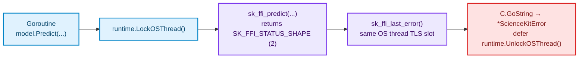

# Errors and Status Codes

Every failure in `sciencekit-go` — whether detected by Go-side input validation, handle lifecycle checks, or the Rust `sciencekit_ffi` library — is returned as a `*sciencekit.ScienceKitError`. The binding never panics on invalid user data or native failures.

## `ScienceKitError` Structure

From `errors.go`:

```go
type ScienceKitError struct {
	// Operation is the binding method that failed.
	Operation string
	// Code is the ABI status code.
	Code Status
	// Message is the native diagnostic, copied out of the thread-local slot.
	Message string
}
```

Its `Error()` string formats the lowercase status name, numeric ABI code, operation name, and diagnostic message:

```text
sciencekit shape (2): predict: feature column count 3 does not match fitted count 2
```

When `Message` is empty, `Error()` formats:

```text
sciencekit <name> (<code>): <operation> failed
```

## Branching on Errors: `IsStatus` and `errors.As`

Use `sciencekit.IsStatus(err, status)` for concise status checks, or standard library `errors.As` when you also want `Operation` and `Message` (derived from `TestNativeErrorCarriesStatusAndMessage` and `TestIsStatusIgnoresUnrelatedErrors` in `errors_test.go`):

```go
predictions, err := model.Predict(wrongShapeMatrix)
if err != nil {
	if sciencekit.IsStatus(err, sciencekit.StatusShape) {
		// Handle dimension mismatch specifically
	}

	var failure *sciencekit.ScienceKitError
	if errors.As(err, &failure) {
		fmt.Printf(
			"operation=%s status=%s (%d) message=%s\n",
			failure.Operation,
			failure.Code.Name(),
			failure.Code,
			failure.Message,
		)
	}
}
```

`IsStatus(nil, sciencekit.StatusOK)` and `IsStatus(errors.New("other"), ...)` both safely return `false`.

## Complete Status Code Mapping

| Go Constant | Numeric Value | `Code.Name()` | Where It Originates |
| --- | --- | --- | --- |
| `StatusUnknown` | `-1` | `"unknown"` | Pointer-returning C entry points (`sk_ffi_fit`, `sk_ffi_builder_create`, or null `sk_ffi_model_load` output) that report failure via `NULL` + thread-local `sk_ffi_last_error()`. Also returned by `Status(n).Name()` for unrecognized integers. |
| `StatusOK` | `0` | `"ok"` | Native success (`SK_FFI_STATUS_OK`); converted to `nil` `error` in Go. |
| `StatusInvalidHandle` | `1` | `"invalid-handle"` | Calling any method (`Fit`, `Predict`, `Score`, `Transform`, `Save`, `IncludeIntercept`, `WithMean`, `WithStd`, `Backend`) on a closed builder or model, or passing an invalid handle at the ABI boundary. |
| `StatusShape` | `2` | `"shape"` | Native dimension mismatch — for example, calling `Predict`, `Score`, or `Transform` with a feature column count different from the matrix passed to `Fit`. |
| `StatusInvalidArgument` | `3` | `"invalid-argument"` | Go-side pre-flight checks (`NewMatrix` with non-positive dimensions or `len(Data) != Rows*Columns`, mismatched `len(targets) != features.Rows`, empty vector, empty persistence `path`, unknown `BackendKind`) or invalid native parameter values. |
| `StatusUnsupported` | `4` | `"unsupported"` | Incompatible `sciencekit_ffi` ABI major version at `init()`, or unsupported persistence operations such as `StandardScalerModel.Save` and `LinearRegressionModel[float32].Save`. |
| `StatusNotFitted` | `5` | `"not-fitted"` | Native `SK_FFI_STATUS_NOT_FITTED` when an estimator state requires fitting. |
| `StatusIO` | `6` | `"io"` | Filesystem I/O errors during `Save` or `LoadLinearRegression` (such as missing files or permission errors). |
| `StatusInternal` | `7` | `"internal"` | Failed C-heap buffer allocation (`C.malloc` / `C.calloc`), unexpected output descriptor dimensionality, or an internal native failure. |

<div class="sk-box sk-box--info">
  <strong>Note on <code>Status.Name()</code> and <code>Status.String()</code>:</strong> For <code>StatusUnknown</code> (<code>-1</code>), <code>Name()</code> returns <code>"unknown"</code> directly in Go. For all other values, <code>Name()</code> queries <code>sk_ffi_status_name(code)</code> in the native library so Go and Rust always agree on the canonical spelling. <code>String()</code> delegates to <code>Name()</code>.
</div>

## Thread-Local Diagnostics and `runtime.LockOSThread`

In `sciencekit_ffi`, detailed human-readable error messages are stored in an OS-thread-local slot accessed via `sk_ffi_last_error()`. Because the Go scheduler can migrate a goroutine between OS threads across calls, `sciencekit-go` wraps every FFI call that reads `sk_ffi_last_error()` inside `runtime.LockOSThread()` / `defer runtime.UnlockOSThread()`:



This guarantees that concurrent goroutines calling `Fit`, `Predict`, `Transform`, or `LoadLinearRegression` never read another goroutine's thread-local diagnostic message.
