# Handle Lifecycle

Builders (`LinearRegressionBuilder[T]`, `StandardScalerBuilder[T]`) and fitted models (`LinearRegressionModel[T]`, `StandardScalerModel[T]`) each wrap an opaque Rust heap allocation (`*C.SKFfiBuilder` or `*C.SKFfiModel`) allocated outside the Go garbage collector's heap.

`sciencekit-go` pairs **explicit `Close()`** with a **`runtime.SetFinalizer` safety net** behind an atomic single-release state machine so native handles are never leaked and never freed twice.

## Recommended Pattern: `defer handle.Close()`

Always pair constructor, `Fit`, and `LoadLinearRegression` calls with `defer ...Close()` right after checking the returned error:

```go
builder, err := sciencekit.NewLinearRegressionBuilder[float64]()
if err != nil {
	return err
}
defer builder.Close()

model, err := builder.Fit(features, targets)
if err != nil {
	return err
}
defer model.Close()
```

Builders and fitted models have **independent lifetimes**: you can `Close()` a `LinearRegressionBuilder` immediately after `Fit` returns, and the resulting `LinearRegressionModel` remains valid until its own `Close()` is called.

## Three Core Guarantees

```mermaid
flowchart LR
    accTitle: Handle lifecycle state machine
    accDescr: A handle starts in Open state when created by NewBuilder, Fit, or LoadLinearRegression. Calling Close or triggering runtime.SetFinalizer transitions it atomically to Closed and calls sk_ffi_builder_free or sk_ffi_model_free once. Subsequent Close calls return nil; operational calls in Closed state return StatusInvalidHandle.
    Create["New*Builder / Fit /<br/>LoadLinearRegression"] --> Open["Open Handle<br/>closed == false"]
    Open -->|"Fit / Predict / Score / Transform"| Open
    Open -->|"First Close() or GC Finalizer"| Free["sk_ffi_*_free()<br/>called once under Lock()"]
    Free --> Closed["Closed Handle<br/>closed == true, native == nil"]
    Closed -->|"Extra Close() → nil"| Closed
    Closed -->|"Any operation"| Invalid["*ScienceKitError<br/>StatusInvalidHandle (1)"]

    classDef init fill:#e0f2fe,stroke:#0284c7,stroke-width:2px,color:#0c4a6e
    classDef open fill:#dcfce7,stroke:#059669,stroke-width:2px,color:#14532d
    classDef close fill:#fef9c3,stroke:#ca8a04,stroke-width:2px,color:#713f12
    classDef err fill:#fee2e2,stroke:#dc2626,stroke-width:2px,color:#7f1d1d
    class Create init
    class Open open
    class Free,Closed close
    class Invalid err
```



### 1. Idempotent Single Release

Calling `Close()` more than once — sequentially or concurrently from multiple goroutines — is guaranteed safe:
- The **first** `Close()` acquires the exclusive lock, flips `closed = true`, clears the internal native pointer to `nil`, and calls `sk_ffi_builder_free` or `sk_ffi_model_free`.
- Every **subsequent** `Close()` sees `closed == true` and returns `nil` immediately without touching C memory (verified by `TestBuilderCloseIsIdempotent` and `TestConcurrentDoubleClose` in `lifecycle_test.go`).

### 2. Use-After-Close Protection (`StatusInvalidHandle`)

Once a builder or model is closed, every operational or configuration method checks `closed` under the lock before reaching `cgo` and fails deterministically with `StatusInvalidHandle` (derived from `TestClosedBuilderFitFails` and `TestClosedModelOperationsFail` in `errors_test.go`):

```go
builder, err := sciencekit.NewStandardScalerBuilder[float64]()
if err != nil {
	return err
}
_ = builder.Close()

err = builder.WithMean(true)
// sciencekit.IsStatus(err, sciencekit.StatusInvalidHandle) == true
```

### 3. `runtime.SetFinalizer` Backup

Every constructor (`NewLinearRegressionBuilder`, `NewStandardScalerBuilder`), `Fit`, and `LoadLinearRegression` registers a Go finalizer (`runtime.SetFinalizer`) that calls `Close()` when the wrapper becomes unreachable.

<div class="sk-box sk-box--warning">
  <strong>Why you should still call <code>Close()</code>:</strong> Go's garbage collector only tracks the tiny Go wrapper struct (a few dozen bytes), not the megabytes a fitted Rust model might hold on the native heap. Under low Go heap pressure, finalizers may run arbitrarily late or not before process exit. Treat <code>Close()</code> as your lifecycle contract and <code>runtime.SetFinalizer</code> as leak insurance.
</div>

## Zero Leaks on Error Paths

Temporary per-call C buffers (`SKFfiArray` input descriptors, output descriptors, and NUL-terminated file path strings) do **not** wait for `Close()` or garbage collection. Every call allocates its descriptors in C memory and releases them via `defer freeDescriptor()` / `C.sk_ffi_array_free` before returning — even when `Fit`, `Predict`, `Transform`, or `Score` fails with an error (`TestRepeatedFailuresDoNotLeak` in `lifecycle_test.go`).
