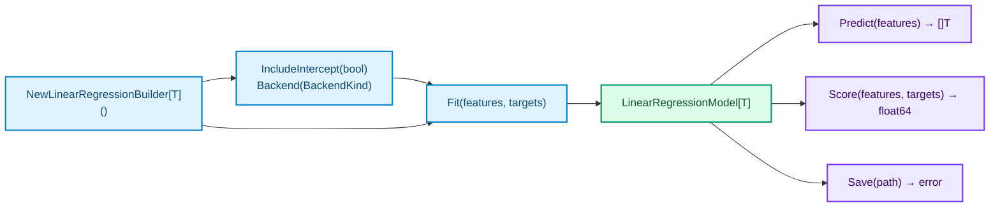

# Linear Regression

`LinearRegressionBuilder[T]` and `LinearRegressionModel[T]` wrap ordinary least squares (`SKLinearRegression` in the Rust core) over `float32`, `float64`, or any named type whose underlying type is `float32` or `float64`.

## Workflow Overview



## Configuring, Fitting, Predicting, and Scoring (`float64`)

Derived from `TestLinearRegressionFitPredictAndScore` in `operations_test.go`:

```go
features, err := sciencekit.NewMatrix(4, 2, []float64{
	0, 0,
	1, 0,
	0, 1,
	2, 3,
})
if err != nil {
	return err
}
targets := []float64{1, 3, 4, 14}

builder, err := sciencekit.NewLinearRegressionBuilder[float64]()
if err != nil {
	return err
}
defer builder.Close()

if err := builder.IncludeIntercept(true); err != nil {
	return err
}
if err := builder.Backend(sciencekit.BackendFaer); err != nil {
	return err
}

model, err := builder.Fit(features, targets)
if err != nil {
	return err
}
defer model.Close()

predictions, err := model.Predict(features)
if err != nil {
	return err
}

rSquared, err := model.Score(features, targets)
if err != nil {
	return err
}
// predictions ≈ [1, 3, 4, 14], rSquared ≈ 1.0
```

## Builder Options

| Method | Default in Native Library | Description |
| --- | --- | --- |
| `IncludeIntercept(enabled bool) error` | `true` | Controls whether the solver fits an additive intercept term (`β₀`). Pass `false` to constrain the hyperplane through the origin. |
| `Backend(kind BackendKind) error` | `BackendFaer` | Selects the linear-algebra backend in the Rust core (`BackendFaer`, `BackendMatrixMultiply`, or `BackendNdArrayLinalg`). Unknown integer values are rejected in Go with `StatusInvalidArgument` before crossing cgo. |

## Single Precision (`float32`) and Named Float Types

The type parameter `T` is constrained by `Float` (`~float32 | ~float64`). Selecting `float32` dispatches to the single-precision `F32` ABI dtype throughout training and prediction, returning `[]float32` from `Predict` while `Score` always returns a `float64` `R²` summary.

Derived from `TestLinearRegressionFloat32` and `TestNamedFloatTypes` in `operations_test.go`:

```go
features, err := sciencekit.NewMatrix(4, 1, []float32{0, 1, 2, 3})
if err != nil {
	return err
}
targets := []float32{1, 3, 5, 7}

builder, err := sciencekit.NewLinearRegressionBuilder[float32]()
if err != nil {
	return err
}
defer builder.Close()

model, err := builder.Fit(features, targets)
if err != nil {
	return err
}
defer model.Close()

predictions, err := model.Predict(features) // []float32
```

Domain-specific named scalar types work seamlessly without casting slices:

```go
type Price float64

features, err := sciencekit.NewMatrix(4, 1, []Price{0, 1, 2, 3})
if err != nil {
	return err
}
builder, err := sciencekit.NewLinearRegressionBuilder[Price]()
if err != nil {
	return err
}
defer builder.Close()

model, err := builder.Fit(features, []Price{1, 3, 5, 7})
if err != nil {
	return err
}
defer model.Close()

predictions, err := model.Predict(features) // []Price
```

## Input Validation Rules

- **Feature matrix (`features`):** Validated in Go before allocating C buffers. Zero/negative dimensions or `len(features.Data) != features.Rows * features.Columns` fail with `StatusInvalidArgument`.
- **Target length (`targets`):** `Fit` and `Score` check `len(targets) == features.Rows` in Go. Mismatched target lengths return `StatusInvalidArgument` (`Operation: "fit"` or `"score"`).
- **Prediction column count:** Calling `Predict` or `Score` with a matrix whose `Columns` differs from the training matrix returns `StatusShape` from the native library, carrying the diagnostic message in `ScienceKitError.Message`.

<div class="sk-box sk-box--info">
  <strong>Reusing a builder:</strong> A single <code>LinearRegressionBuilder[T]</code> can call <code>Fit</code> multiple times across different datasets (and even across goroutines; calls are serialized internally). Closing the builder does not invalidate models already returned by <code>Fit</code>.
</div>
