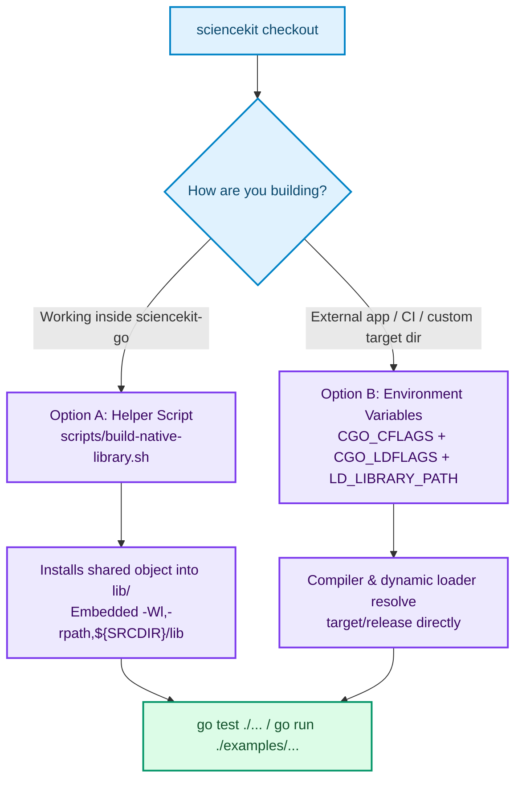

# Installation

`sciencekit-go` links against the shared C ABI library (`sciencekit_ffi`) built from the main [`neurono-ml/sciencekit`](https://github.com/neurono-ml/sciencekit) Rust workspace. This page walks through toolchain requirements, building the shared object, and the two supported ways to link it with `go build`, `go run`, and `go test`.

## Prerequisites

- **Go 1.22 or newer** with `cgo` enabled (`CGO_ENABLED=1`, the default whenever a C compiler is installed on the host).
- **A C toolchain** (`cc`, `clang`, or `gcc`).
- **Rust 1.85 or newer** (`cargo` and `rustc`) to compile `sciencekit_ffi` from source, or a prebuilt `sciencekit_ffi` shared library for your platform.

## Add the Go Module

In your Go module, add `github.com/neurono-ml/sciencekit-go`:

```sh
go get github.com/neurono-ml/sciencekit-go
```

Or clone the binding repository directly when running its examples and test suite:

```sh
git clone https://github.com/neurono-ml/sciencekit-go.git
cd sciencekit-go
```

## Step 1 — Build `sciencekit_ffi` from the Main Repository

Clone [`neurono-ml/sciencekit`](https://github.com/neurono-ml/sciencekit) and build the `sciencekit_ffi` crate in release mode:

```sh
git clone https://github.com/neurono-ml/sciencekit.git
cd sciencekit
cargo build -p sciencekit_ffi --release
```

Cargo places the compiled shared library under `target/release/` (or `$CARGO_TARGET_DIR/release/` if `CARGO_TARGET_DIR` is set):

| Platform | Shared Library Artifact | Runtime Loader Variable |
| --- | --- | --- |
| Linux | `target/release/libsciencekit_ffi.so` | `LD_LIBRARY_PATH` |
| macOS | `target/release/libsciencekit_ffi.dylib` | `DYLD_LIBRARY_PATH` |
| Windows (MSYS / MinGW) | `target/release/sciencekit_ffi.dll` | `PATH` |

---

## Step 2 — Link the Shared Library



### Option A — Helper Script into `lib/` (Recommended for Local Development)

The repository includes `cgo` directives in `cgo.go` and `native_model.go` that already point at the vendored `include/` directory and `lib/` with an embedded runtime search path (`-Wl,-rpath,${SRCDIR}/lib`):

```go
// #cgo CFLAGS: -I${SRCDIR}/include
// #cgo LDFLAGS: -L${SRCDIR}/lib -Wl,-rpath,${SRCDIR}/lib -lsciencekit_ffi
```

Run `scripts/build-native-library.sh` to invoke `cargo build -p sciencekit_ffi --release` and copy the resulting shared library into `lib/`:

```sh
scripts/build-native-library.sh /path/to/sciencekit
go test ./...
```

How `scripts/build-native-library.sh` locates the Rust repository:
1. First positional argument (`/path/to/sciencekit`), if passed.
2. Otherwise `$SCIENCEKIT_REPOSITORY`, if set.
3. Otherwise a sibling `../sciencekit` directory next to `sciencekit-go`.
4. Respects `$CARGO_TARGET_DIR` when locating the built `release` artifact.

<div class="sk-box sk-box--success">
  <strong>Zero environment variables afterwards:</strong> Because the cgo directive embeds <code>-Wl,-rpath,${SRCDIR}/lib</code>, every subsequent <code>go test ./...</code> and <code>go run ./examples/...</code> finds <code>libsciencekit_ffi</code> automatically without setting <code>LD_LIBRARY_PATH</code>. (<code>/lib/*.so</code>, <code>/lib/*.dylib</code>, and <code>/lib/*.dll</code> are git-ignored so binary artifacts are never committed.)
</div>

### Option B — `CGO_CFLAGS`, `CGO_LDFLAGS`, and `LD_LIBRARY_PATH`

When consuming `github.com/neurono-ml/sciencekit-go` as an external Go module dependency, in CI pipelines, or against a shared library installed outside `lib/`, export standard `cgo` and dynamic-linker variables:

```sh
export CGO_CFLAGS="-I/path/to/sciencekit/crates/sciencekit_ffi/include"
export CGO_LDFLAGS="-L/path/to/sciencekit/target/release -lsciencekit_ffi"
export LD_LIBRARY_PATH="/path/to/sciencekit/target/release:${LD_LIBRARY_PATH:-}"
go test ./...
```

On **macOS**, substitute `DYLD_LIBRARY_PATH` for `LD_LIBRARY_PATH`:

```sh
export DYLD_LIBRARY_PATH="/path/to/sciencekit/target/release:${DYLD_LIBRARY_PATH:-}"
```

`go` prepends `CGO_CFLAGS` and `CGO_LDFLAGS` ahead of the package's `#cgo` directives, so the paths you export always take precedence over the vendored `include/` header and `lib/` directory.

---

## Keeping the Vendored Header in Sync

`include/sciencekit.h` is vendored inside `sciencekit-go` so static analysis and compilation know the exact C declarations before linking. Whenever `crates/sciencekit_ffi/include/sciencekit.h` changes upstream, synchronize it with:

```sh
scripts/sync-header.sh /path/to/sciencekit
```

Like the build script, `scripts/sync-header.sh` accepts a path argument, `$SCIENCEKIT_REPOSITORY`, or a sibling `../sciencekit` checkout. The CI workflow runs `scripts/sync-header.sh` automatically on every pull request to verify there is no drift against upstream `sciencekit`.

## Verify Your Installation

Run the full test suite — including the Go race detector and strict `cgo` pointer checking — to confirm everything links and executes cleanly:

```sh
go test ./...
go test -race ./...
GOEXPERIMENT=cgocheck2 go test ./...
```
