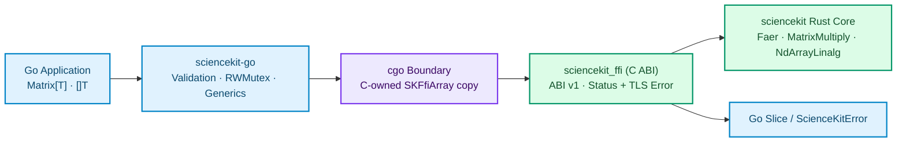

# Introduction

<div class="sk-hero reveal">
  <div class="sk-announce">
    <span class="sk-announce__tag">Go 1.22+ · cgo</span>
    Typed Go bindings over the stable <code>sciencekit_ffi</code> C ABI
  </div>
  <h1 class="sk-hero__title">sciencekit for Go</h1>
  <p class="sk-hero__subtitle">
    Bring the native Rust performance of <a href="https://github.com/neurono-ml/sciencekit">sciencekit</a> to Go applications through typed generic builders, safe C-owned descriptors, structured errors, and deterministic handle lifecycles — without a single line of <code>unsafe</code> in caller code.
  </p>
</div>

```go
import sciencekit "github.com/neurono-ml/sciencekit-go"
```

<div class="sk-stats reveal">
  <div class="sk-stats__item">
    <div class="sk-stats__value js-count" data-target="2">2</div>
    <span class="sk-stats__label">scalar precisions (<code>float32</code>, <code>float64</code>)</span>
  </div>
  <div class="sk-stats__item">
    <div class="sk-stats__value js-count" data-target="3">3</div>
    <span class="sk-stats__label">selectable math backends</span>
  </div>
  <div class="sk-stats__item">
    <div class="sk-stats__value js-count" data-target="0">0</div>
    <span class="sk-stats__label">Go pointers stored in C memory</span>
  </div>
</div>

## What `sciencekit` Is

[**sciencekit**](https://github.com/neurono-ml/sciencekit) is a machine-learning library written natively in Rust (edition 2024, MSRV 1.85) that reimplements scikit-learn with extreme numerical performance, selectable linear-algebra backends (`faer`, `matrixmultiply`, `ndarray-linalg`), deterministic execution, and a portable model state format.

Rather than reimplementing numerical algorithms separately in every host language — an approach that guarantees drift in edge cases, numerical precision, and persisted state — `sciencekit` exposes a versioned, C-compatible shared library crate named **`sciencekit_ffi`** (`crates/sciencekit_ffi` in the main repository).

## What the Go Binding Exposes

`github.com/neurono-ml/sciencekit-go` is a thin, idiomatic Go module built with `cgo` on top of `sciencekit_ffi`. Every capability exposed by the C ABI is surfaced as strongly typed Go generics constrained by `Float` (`~float32 | ~float64`):

<div class="sk-cards reveal">
  <div class="sk-card">
    <span class="sk-card__icon sk-icon--sky">📐</span>
    <div class="sk-card__title">Typed Generic Estimators</div>
    <p><code>LinearRegressionBuilder[T]</code> (<code>Fit</code>, <code>Predict</code>, <code>Score</code>, <code>Save</code>) and <code>StandardScalerBuilder[T]</code> (<code>Fit</code>, <code>Transform</code>, <code>Save</code>) parameterized over <code>float32</code>, <code>float64</code>, or named float types.</p>
  </div>
  <div class="sk-card">
    <span class="sk-card__icon sk-icon--emerald">🛡️</span>
    <div class="sk-card__title">Strict cgo Safety</div>
    <p>Every <code>Matrix[T]</code> and target slice crosses the FFI boundary as a temporary C-owned copy allocated via <code>C.malloc</code>, satisfying <code>GOEXPERIMENT=cgocheck2</code> and keeping the Go garbage collector free to move or reclaim slices.</p>
  </div>
  <div class="sk-card">
    <span class="sk-card__icon sk-icon--violet">⚡</span>
    <div class="sk-card__title">Concurrency-Ready Handles</div>
    <p>Fitted models guard their immutable native pointer with <code>sync.RWMutex</code> so arbitrarily many goroutines can call <code>Predict</code>, <code>Score</code>, or <code>Transform</code> simultaneously, while builders serialize calls with <code>sync.Mutex</code>.</p>
  </div>
  <div class="sk-card">
    <span class="sk-card__icon sk-icon--amber">🔍</span>
    <div class="sk-card__title">Structured Diagnostics</div>
    <p>Every failure returns <code>*ScienceKitError</code> carrying the ABI <code>Status</code> code, failing <code>Operation</code>, and thread-local native diagnostic message, queryable with <code>IsStatus(err, status)</code> or <code>errors.As</code>.</p>
  </div>
</div>

## How `sciencekit-go` Relates to the Rust Core

The Go module used to live under `go/` inside the main `sciencekit` repository and now lives in its own standalone module repository ([`neurono-ml/sciencekit-go`](https://github.com/neurono-ml/sciencekit-go)). The two repositories meet at a single contract: the `include/sciencekit.h` header and the compiled `sciencekit_ffi` shared library (`libsciencekit_ffi.so`, `libsciencekit_ffi.dylib`, or `sciencekit_ffi.dll`).



### ABI Verification at Initialization

When your Go program imports `github.com/neurono-ml/sciencekit-go`, its `init()` function immediately queries `sk_ffi_version` on a locked OS thread and checks that the loaded shared library's `Major` version matches the ABI major version implemented by the Go binding (`1`). Any ABI major mismatch is captured up front and reported as `StatusUnsupported` (`Operation: "abi_version"`) before any builder or model is constructed:

```go
version, err := sciencekit.Version()
if err != nil {
    log.Fatal(err)
}
fmt.Printf("Loaded sciencekit_ffi ABI v%d.%d.%d\n", version.Major, version.Minor, version.Patch)

if sciencekit.HasFeature(sciencekit.FeatureLinearRegression | sciencekit.FeatureF64) {
    fmt.Println("Double-precision linear regression is available")
}
```

## Explicit Scope and Non-Goals

<div class="sk-box sk-box--info">
  <strong>Thin wrapper by design:</strong> Estimator families, math backends, and persistence rules in <code>sciencekit-go</code> mirror what <code>sciencekit_ffi</code> exports. Reimplementing estimators in pure Go, hiding cgo behind background channels, GPU kernels, or storing raw Go slice pointers inside C structures are explicit non-goals.
</div>

| Capability | Current Status | Notes |
| --- | --- | --- |
| Linear regression (`float32`, `float64`) | <span class="sk-pill sk-pill--emerald">Supported</span> | `IncludeIntercept`, `Backend`, `Fit`, `Predict`, `Score`, `Save` |
| Standard scaler (`float32`, `float64`) | <span class="sk-pill sk-pill--emerald">Supported</span> | `WithMean`, `WithStd`, `Backend`, `Fit`, `Transform` |
| Model persistence (`Save` / `LoadLinearRegression`) | <span class="sk-pill sk-pill--sky">f64 Linear Regression</span> | Scaler and `float32` persistence return `StatusUnsupported` |
| Named floating-point types (`type Score float64`) | <span class="sk-pill sk-pill--emerald">Supported</span> | Constrained via `~float32 \| ~float64` |
| Concurrent model inference across goroutines | <span class="sk-pill sk-pill--emerald">Supported</span> | Shared read lock (`sync.RWMutex`) |

## Where to Go Next

- **[Installation](installation.md)** — compile `sciencekit_ffi`, run `scripts/build-native-library.sh`, or configure `CGO_CFLAGS`, `CGO_LDFLAGS`, and `LD_LIBRARY_PATH`.
- **[Quickstart](quickstart.md)** — run complete linear-regression and standard-scaler programs end to end.
- **[API Reference](api-reference.md)** — inspect every exported Go type, constant, function, and method signature.
